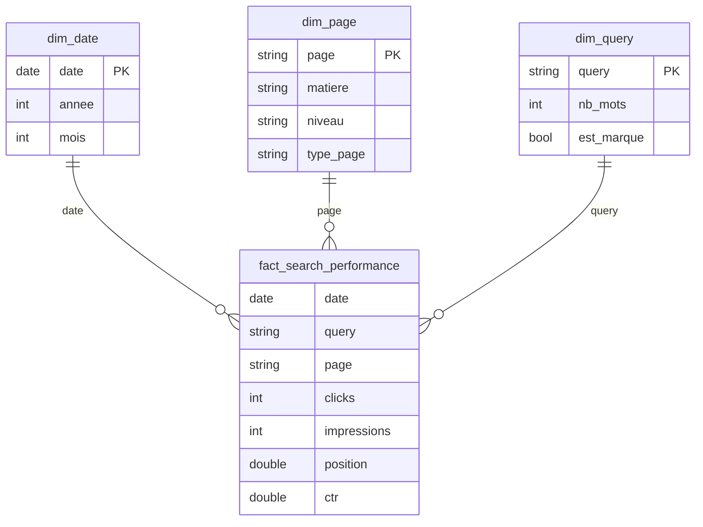
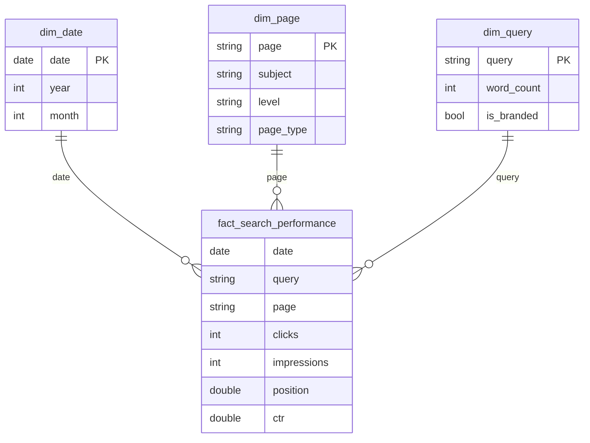

# SEO — Organic Search Growth Analysis · revisio.fr

> **Le problème n'est pas le taux de clic, c'est le rang.** 52 % des impressions stagnent en page 2 de Google.
> *The bottleneck isn't CTR, it's rank. 52% of impressions are stuck on page 2.*

De la donnée brute Google Search Console au **plan d'action éditorial sur 58 URLs** : pipeline **ETL automatisé** (Python · DuckDB · Parquet) → **modèle en étoile** → **dashboard Power BI** décisionnel.

**🇫🇷 [Version française](#-version-française) · 🇬🇧 [English version](#-english-version)**

---
---

# 🇫🇷 Version française

## 1. Le projet en une phrase

revisio.fr (site EdTech) publie beaucoup de contenu mais ne sait pas **où investir**. Ce projet transforme 3 millions d'impressions Search Console en une réponse chiffrée : *quelles URLs travailler, avec quel levier, pour combien de clics gagnés.*

## 2. Contexte & problème métier

revisio.fr propose fiches, cours, exercices et quiz par matière et niveau. Son premier levier d'acquisition gratuit est le **SEO**. L'équipe contenu publie beaucoup de pages mais ne sait pas objectivement où investir : les données Search Console sont volumineuses et sous-exploitées, l'effort éditorial se disperse, des opportunités sont manquées.

**Questions traitées :**

- Quelles pages sont en *striking distance* (position 11-20, presque en page 1) = **quick wins** ?
- Quelles pages ont beaucoup d'impressions mais peu de clics (**titres à réécrire**) ?
- Notre CTR de 2,63 % est-il bon ou mauvais ?
- Quelle est la **vraie** croissance, une fois la saisonnalité des examens neutralisée ?

## 3. Résultats clés

| Indicateur | Valeur |
|---|---|
| Clics | 79 946 |
| Impressions | 3 037 411 |
| CTR moyen | **2,63 %** |
| CTR attendu (vu le mix de positions) | **2,63 %** → écart ≈ 0 |
| Position moyenne pondérée | 13,8 |
| URLs avec action identifiée | **58 / 87** |

**Le goulot d'étranglement :**

| Palier | % impressions | % clics | CTR |
|---|---|---|---|
| Page 1 (top 10) | 30,2 % | 66,8 % | 5,81 % |
| **Page 2 (11-20)** | **52,0 %** | 28,5 % | 1,44 % |
| Page 3 (21-30) | 17,4 % | 4,7 % | 0,70 % |
| Page 4+ | 0,3 % | 0,1 % | 0,52 % |

**Deux leviers, chiffrés :**

| Levier | Gisement | Poids |
|---|---|---|
| Remonter les pages en page 1 (**ranking**) | **+15 942 clics** | ~17× |
| Réécrire les titres/meta (**CTR**) | +946 clics | 1× |

**L'insight central.** Un CTR de 2,63 % semble faible… jusqu'à ce qu'on le compare au CTR *attendu* pour la répartition des positions du site : **2,63 % également**. Le CTR est donc exactement au niveau prévisible. Le levier n'est pas le clic — c'est le **rang**. Ce raisonnement évite une erreur classique : réécrire des centaines de titres pour un gain marginal, au lieu de travailler le classement.

## 4. Pipeline ETL — le cœur technique

```
gsc_raw.csv  (source Search Console)
     │
     │  PHASE 1 — Exploration & modélisation (marimo)
     │  • diagnostic qualité : doublons, valeurs manquantes, unicité de clé
     │  • nettoyage
     │  • construction du schéma en étoile en SQL (DuckDB)
     ▼
dim_date · dim_page · dim_query · fact_search_performance
     │
     │  PHASE 2 — Pipeline ETL automatisé
     │  • chaque étape encapsulée en fonction réutilisable
     │  • un « chef d'orchestre » enchaîne les étapes
     │  • export Parquet via DuckDB (write_parquet)
     │  • TEST D'ÉQUIVALENCE : assert_frame_equal(pandas, ETL)
     ▼
modele_etoile_ETL/*.parquet   (544 Ko, typé, compressé)
     │
     ▼
Power BI Desktop  →  mesures DAX  →  dashboard 3 pages
```

Le **test d'équivalence** est le garde-fou du projet : il vérifie, table par table, que la version automatisée produit **exactement** le même résultat que l'exploration manuelle. Un pipeline qui tourne ne suffit pas — il faut prouver qu'il tourne *juste*.

**Pourquoi Parquet plutôt que CSV ?** Format **colonnaire et compressé** : 544 Ko contre 15 Mo en CSV (~28× plus léger), **typage préservé** (une date reste une date, pas du texte), et lecture nettement plus rapide par Power BI.

## 5. Modèle de données (schéma en étoile)



Relations *plusieurs-à-un*, sens de filtre unique (dimension → fait).
**Volumétrie :** 109 352 lignes de faits · 87 pages · 162 requêtes · 9 matières · 471 jours (01/03/2025 → 15/06/2026).

## 6. 🔌 Importer les fichiers Parquet dans Power BI Desktop

Power BI possède un **connecteur Parquet natif**. La démarche complète :

**Étape 1 — Connecter le premier fichier**

1. Ruban **Accueil** → **Obtenir les données** → **Plus…**
2. Dans la recherche, taper **`Parquet`** → catégorie **Fichier** → sélectionner **Parquet** → **Se connecter**
3. **Parcourir** → choisir `Phase1_Donnees_Modele/data/modele_etoile_ETL/dim_date.parquet` → **Ouvrir** → **OK**
4. L'aperçu s'affiche → cliquer **Transformer les données** (pour vérifier les types) ou **Charger**

**Étape 2 — Répéter pour les 4 tables**
`dim_date.parquet` · `dim_page.parquet` · `dim_query.parquet` · `fact_search_performance.parquet`

Sous le capot, Power Query génère ce code M :

```m
let
    Source = Parquet.Document(
        File.Contents("C:\...\modele_etoile_ETL\dim_page.parquet"),
        [Compression=null, LegacyColumnNameEncoding=false, MaxDepth=null]
    )
in
    Source
```

### ⚠️ Le piège du chemin absolu

Ce chemin pointe vers **une machine précise**. Si vous clonez ce repo, l'actualisation échouera : le chemin n'existe pas chez vous. C'est le défaut n°1 des `.pbix` partagés.

### ✅ La correction professionnelle : un paramètre Power Query

1. **Accueil → Transformer les données** (ouvre l'éditeur Power Query)
2. **Accueil → Gérer les paramètres → Nouveau paramètre**
   - **Nom** : `CheminDonnees`
   - **Type** : Texte
   - **Valeur actuelle** : le chemin de *votre* dossier `modele_etoile_ETL`
3. Pour chacune des 4 requêtes → **Affichage → Éditeur avancé** → remplacer le chemin en dur par le paramètre :

```m
let
    Source = Parquet.Document(
        File.Contents(CheminDonnees & "\dim_page.parquet"),
        [Compression=null, LegacyColumnNameEncoding=false, MaxDepth=null]
    )
in
    Source
```

4. **Fermer et appliquer**

Résultat : après un clone, **une seule valeur à changer** (le paramètre) et les 4 tables se rechargent. C'est la différence entre un `.pbix` « qui marche chez moi » et un livrable réellement portable.

### Étape 3 — Finaliser le modèle

- **Vue Modèle** : vérifier les 3 relations `fact → dim_*` (plusieurs-à-un, sens unique).
- **Marquer `dim_date` comme table de dates** : sélectionner la table → *Outils de table* → **Marquer comme table de dates** → colonne `date`. Indispensable pour les calculs temporels (YoY).

## 7. Mesures DAX notables

**CTR attendu, dérivé des données** (et non de seuils arbitraires) — une colonne matérialise la courbe CTR × position réellement observée :

```dax
ctr_attendu_ligne =                       -- colonne calculée (table de faits)
VAR p = ROUND( fact_search_performance[position], 0 )
RETURN SWITCH( TRUE(),
    p<=1, 0.3429, p=2, 0.1684, p=3, 0.1008, /* … */ p=20, 0.0089, 0.0070 )

CTR attendu = DIVIDE( [Clics attendus], [Total Impressions] )
```

**Les deux leviers, sommés par page** (donc corrects à tous les niveaux d'agrégation) :

```dax
Gain potentiel (clics) =                  -- levier RANKING
    SUMX( VALUES(dim_page[page]),
        VAR ctr = [CTR %]  VAR pos = [Position moyenne]  VAR cible = [Cible CTR page 1]
        RETURN IF( pos > 10 && (cible - ctr) > 0,
                   ROUND( [Total Impressions] * (cible - ctr), 0 ) ) )
```

**YoY contextuel** — valeur du mois dans un graphique, dernier mois *complet* sur une carte globale (le test `EOMONTH` neutralise un mois partiel) :

```dax
Clics YoY % =
    IF( HASONEVALUE(dim_date[AnneeMois]),
        DIVIDE( [Total Clics] - [Clics N-1], [Clics N-1] ),   -- grain mois
        [Clics YoY % (dernier mois complet)] )                -- grain agrégé
```

## 8. Dashboard — 3 pages

| Page | Question | Contenu |
|---|---|---|
| **1 · Performance** | *Où en est-on ?* | KPI (CTR réel **vs** CTR attendu, YoY), saisonnalité + année N-1, clics par matière, marque vs hors-marque |
| **2 · Diagnostic** | *Pourquoi ?* | Courbe CTR × position, goulot par palier, drivers du ranking, paradoxe position × CTR |
| **3 · Plan d'action** | *Quoi faire ?* | Gisement par levier, table des 58 URLs (levier + gain), Pareto |

## 9. Lancer le dashboard en local

Ce dépôt embarque **la sortie du pipeline ETL** (les 4 fichiers Parquet, 544 Ko) et l'application qui les exploite. Trois commandes suffisent :

```bash
git clone https://github.com/Nha-Bssha/SEO-organic-growth-analysis.git
cd SEO-organic-growth-analysis
pip install -r requirements.txt
streamlit run app.py
```

L'app s'ouvre sur `localhost:8501`. **Aucune base de données, aucun serveur** : elle lit directement les Parquet.

> Le notebook ETL (marimo) et le modèle Power BI qui ont produit ces Parquet sont documentés aux sections 4 à 7. Ce dépôt ne publie que le **livrable exécutable** et sa documentation, pour rester léger.

## 10. Dashboard Streamlit (open source)

Le même dashboard, en **application Python interactive** — filtres réels (matière, niveau, type, palier), paramètres du modèle ajustables, plan d'action exportable en CSV, bascule **FR/EN**. Il lit **directement les Parquet** : aucune base, aucun serveur.

```bash
streamlit run app.py
```

**Déploiement sur Streamlit Community Cloud :**

1. Aller sur [share.streamlit.io](https://share.streamlit.io) → *New app*.
2. Repo : `Nha-Bssha/SEO-organic-growth-analysis` · Branche : `main` · Fichier : `app.py`.
3. *Deploy*. L'environnement est construit à partir de `requirements.txt`.

⚠️ **Piège classique :** Community Cloud démarre l'app depuis la **racine du repo**, même si le script est ailleurs. Les chemins de données sont donc écrits relativement à la racine (`Phase1_Donnees_Modele/data/modele_etoile_ETL/...`), et non au dossier du script.

## 11. Arborescence

```
├── README.md                            Doc technique + valeur métier
├── requirements.txt
├── .gitignore
├── app.py                               Dashboard Streamlit bilingue (FR/EN)
├── .streamlit/config.toml               Thème de l'app
└── Phase1_Donnees_Modele/data/modele_etoile_ETL/
    ├── dim_date.parquet                 Sortie du pipeline ETL :
    ├── dim_page.parquet                 le schéma en étoile matérialisé
    ├── dim_query.parquet                (544 Ko, typé, compressé)
    └── fact_search_performance.parquet
```

Dépôt volontairement **minimal** : le strict nécessaire pour exécuter le dashboard, plus la documentation.

## 11. Limites

Search Console révèle les **symptômes** (position, impressions, CTR), pas toutes les **causes** du classement (backlinks, profondeur du contenu, intention). GSC dit *où* agir ; le *comment* se pilote avec des outils complémentaires (crawler, Ahrefs/Semrush). Données synthétiques réalistes ; le modèle est prêt à recevoir un export GSC réel sans modification.

## 12. Stack

**Python** (pandas, DuckDB, marimo) · **Parquet** · **Power BI / DAX** (schéma en étoile, time-intelligence) · **Plotly** (maquette HTML)

---
---

# 🇬🇧 English version

## 1. The project in one sentence

revisio.fr (an EdTech site) publishes a lot of content but doesn't know **where to invest**. This project turns 3 million Search Console impressions into a quantified answer: *which URLs to work on, with which lever, for how many clicks gained.*

## 2. Context & business problem

revisio.fr offers study sheets, courses, exercises and quizzes by subject and school level. Its main free acquisition channel is **SEO**. The content team ships many pages but has no objective way to prioritise: Search Console data is large and underused, editorial effort is scattered, opportunities are missed.

**Questions answered:**

- Which pages are within *striking distance* (position 11-20, just off page 1) = **quick wins**?
- Which pages get many impressions but few clicks (**titles to rewrite**)?
- Is our 2.63% CTR good or bad?
- What is the **real** growth, once exam seasonality is stripped out?

## 3. Key findings

| Metric | Value |
|---|---|
| Clicks | 79,946 |
| Impressions | 3,037,411 |
| Average CTR | **2.63%** |
| Expected CTR (given position mix) | **2.63%** → gap ≈ 0 |
| Weighted average position | 13.8 |
| URLs with an identified action | **58 / 87** |

**The bottleneck:**

| Tier | % impressions | % clicks | CTR |
|---|---|---|---|
| Page 1 (top 10) | 30.2% | 66.8% | 5.81% |
| **Page 2 (11-20)** | **52.0%** | 28.5% | 1.44% |
| Page 3 (21-30) | 17.4% | 4.7% | 0.70% |
| Page 4+ | 0.3% | 0.1% | 0.52% |

**Two levers, quantified:**

| Lever | Opportunity | Weight |
|---|---|---|
| Push pages onto page 1 (**ranking**) | **+15,942 clicks** | ~17× |
| Rewrite titles/meta (**CTR**) | +946 clicks | 1× |

**The core insight.** A 2.63% CTR looks weak — until you compare it to the CTR *expected* for the site's actual position mix: **also 2.63%**. The CTR is exactly where it should be. The lever isn't the click, it's the **rank**. This reasoning avoids a classic mistake: rewriting hundreds of titles for marginal gain instead of fixing rankings.

## 4. ETL pipeline — the technical core

```
gsc_raw.csv  (Search Console export)
     │
     │  PHASE 1 — Exploration & modelling (marimo)
     │  • data-quality diagnostics: duplicates, nulls, key uniqueness
     │  • cleaning
     │  • star schema built in SQL (DuckDB)
     ▼
dim_date · dim_page · dim_query · fact_search_performance
     │
     │  PHASE 2 — Automated ETL pipeline
     │  • each step wrapped in a reusable function
     │  • an orchestrator chains the steps
     │  • Parquet export via DuckDB (write_parquet)
     │  • EQUIVALENCE TEST: assert_frame_equal(pandas, ETL)
     ▼
modele_etoile_ETL/*.parquet   (544 KB, typed, compressed)
     │
     ▼
Power BI Desktop  →  DAX measures  →  3-page dashboard
```

The **equivalence test** is the project's safety net: table by table, it proves the automated pipeline returns **exactly** the same result as the manual exploration. A pipeline that runs isn't enough — you must prove it runs *correctly*.

**Why Parquet over CSV?** Columnar and compressed: 544 KB vs 15 MB as CSV (~28× smaller), **types preserved** (a date stays a date, not text), and much faster to load in Power BI.

## 5. Data model (star schema)



Many-to-one relationships, single filter direction (dimension → fact).
**Volume:** 109,352 fact rows · 87 pages · 162 queries · 9 subjects · 471 days (2025-03-01 → 2026-06-15).

## 6. 🔌 Loading the Parquet files into Power BI Desktop

Power BI ships a **native Parquet connector**. Full walkthrough:

**Step 1 — Connect the first file**

1. **Home** ribbon → **Get data** → **More…**
2. Search **`Parquet`** → **File** category → select **Parquet** → **Connect**
3. **Browse** → pick `Phase1_Donnees_Modele/data/modele_etoile_ETL/dim_date.parquet` → **Open** → **OK**
4. Preview appears → click **Transform Data** (to check types) or **Load**

**Step 2 — Repeat for all 4 tables**
`dim_date.parquet` · `dim_page.parquet` · `dim_query.parquet` · `fact_search_performance.parquet`

Under the hood, Power Query generates this M code:

```m
let
    Source = Parquet.Document(
        File.Contents("C:\...\modele_etoile_ETL\dim_page.parquet"),
        [Compression=null, LegacyColumnNameEncoding=false, MaxDepth=null]
    )
in
    Source
```

### ⚠️ The hard-coded path trap

That path points to **one specific machine**. If you clone this repo, refresh will fail — the path doesn't exist on your computer. This is the #1 flaw of shared `.pbix` files.

### ✅ The professional fix: a Power Query parameter

1. **Home → Transform data** (opens the Power Query editor)
2. **Home → Manage parameters → New parameter**
   - **Name**: `CheminDonnees`
   - **Type**: Text
   - **Current value**: the path to *your* `modele_etoile_ETL` folder
3. For each of the 4 queries → **View → Advanced Editor** → swap the hard-coded path for the parameter:

```m
let
    Source = Parquet.Document(
        File.Contents(CheminDonnees & "\dim_page.parquet"),
        [Compression=null, LegacyColumnNameEncoding=false, MaxDepth=null]
    )
in
    Source
```

4. **Close & Apply**

Result: after a clone, you change **a single value** (the parameter) and all four tables reload. That's the difference between a `.pbix` that "works on my machine" and a genuinely portable deliverable.

### Step 3 — Finalise the model

- **Model view**: check the 3 `fact → dim_*` relationships (many-to-one, single direction).
- **Mark `dim_date` as a date table**: select it → *Table tools* → **Mark as date table** → column `date`. Required for time-intelligence (YoY).

## 7. Notable DAX measures

**Expected CTR, derived from the data** (not from arbitrary thresholds) — a calculated column materialises the actually-observed CTR × position curve:

```dax
ctr_attendu_ligne =                       -- calculated column (fact table)
VAR p = ROUND( fact_search_performance[position], 0 )
RETURN SWITCH( TRUE(),
    p<=1, 0.3429, p=2, 0.1684, p=3, 0.1008, /* … */ p=20, 0.0089, 0.0070 )

CTR attendu = DIVIDE( [Clics attendus], [Total Impressions] )
```

**Both levers, summed per page** (hence correct at every aggregation level):

```dax
Gain potentiel (clics) =                  -- RANKING lever
    SUMX( VALUES(dim_page[page]),
        VAR ctr = [CTR %]  VAR pos = [Position moyenne]  VAR cible = [Cible CTR page 1]
        RETURN IF( pos > 10 && (cible - ctr) > 0,
                   ROUND( [Total Impressions] * (cible - ctr), 0 ) ) )
```

**Context-aware YoY** — the month's value inside a chart, the last *complete* month on a global card (the `EOMONTH` test neutralises a partial month):

```dax
Clics YoY % =
    IF( HASONEVALUE(dim_date[AnneeMois]),
        DIVIDE( [Total Clics] - [Clics N-1], [Clics N-1] ),   -- month grain
        [Clics YoY % (dernier mois complet)] )                -- aggregated grain
```

## 8. Dashboard — 3 pages

| Page | Question | Content |
|---|---|---|
| **1 · Performance** | *Where do we stand?* | KPIs (actual **vs** expected CTR, YoY), seasonality + prior year, clicks by subject, branded vs non-branded |
| **2 · Diagnostic** | *Why?* | CTR × position curve, bottleneck by tier, ranking drivers, position × CTR paradox |
| **3 · Action plan** | *What to do?* | Opportunity by lever, table of 58 URLs (lever + gain), Pareto |

## 9. Run the dashboard locally

This repo ships **the ETL pipeline's output** (the 4 Parquet files, 544 KB) and the app that consumes them. Three commands:

```bash
git clone https://github.com/Nha-Bssha/SEO-organic-growth-analysis.git
cd SEO-organic-growth-analysis
pip install -r requirements.txt
streamlit run app.py
```

The app opens at `localhost:8501`. **No database, no backend** — it reads the Parquet files directly.

> The marimo ETL notebook and the Power BI model that produced these Parquet files are documented in sections 4-7. This repo publishes only the **runnable deliverable** and its documentation, to stay lightweight.

## 10. Streamlit dashboard (open source)

The same dashboard as an **interactive Python app** — real filters (subject, level, page type, tier), adjustable model parameters, CSV-exportable action plan, **FR/EN** toggle. It reads the **Parquet files directly**: no database, no backend.

```bash
streamlit run app.py
```

**Deploying to Streamlit Community Cloud:**

1. Go to [share.streamlit.io](https://share.streamlit.io) → *New app*.
2. Repo: `Nha-Bssha/SEO-organic-growth-analysis` · Branch: `main` · File: `app.py`.
3. *Deploy*. The environment is built from `requirements.txt`.

⚠️ **Classic pitfall:** Community Cloud always starts the app from the **repo root**, even when the script lives elsewhere. Data paths are therefore written relative to the root (`Phase1_Donnees_Modele/data/modele_etoile_ETL/...`), not to the script's folder.

## 11. Repository structure

```
├── README.md                            Technical doc + business value
├── requirements.txt
├── .gitignore
├── app.py                               Bilingual Streamlit dashboard (FR/EN)
├── .streamlit/config.toml               App theme
└── Phase1_Donnees_Modele/data/modele_etoile_ETL/
    ├── dim_date.parquet                 ETL pipeline output:
    ├── dim_page.parquet                 the materialised star schema
    ├── dim_query.parquet                (544 KB, typed, compressed)
    └── fact_search_performance.parquet
```

Deliberately **minimal** repo: strictly what's needed to run the dashboard, plus the documentation.

## 11. Limitations

Search Console reveals **symptoms** (position, impressions, CTR), not every **cause** of ranking (backlinks, content depth, intent). GSC tells you *where* to act; the *how* is driven with complementary tools (crawler, Ahrefs/Semrush). Data is realistic-synthetic; the model accepts a real GSC export with no changes.

## 12. Stack

**Python** (pandas, DuckDB, marimo) · **Parquet** · **Power BI / DAX** (star schema, time-intelligence) · **Plotly** (HTML mockup)
